# WeatherPulse Codebase Analysis & Architecture Report

**Project Stack:** Next.js 16 (App Router), React 19, TypeScript, Tailwind CSS 4, MongoDB + Mongoose  
**Generated On:** 2026-11-09  
**Scope:** Complete repository architecture inspection, existing inventory, data flow, bugs, security findings, synthetic mock analysis, and ML forecasting roadmap.

---

## 1. Repository Architecture & Directory Structure

```
weather-major/
├── public/
│   ├── app-icon.svg
│   ├── manifest.json                  # PWA configuration
│   └── ...                            # Static SVG/icon assets
├── src/
│   ├── app/
│   │   ├── api/
│   │   │   ├── cron/cleanup/route.ts       # Automated TTL cleanup for Cloudinary & MongoDB
│   │   │   ├── geocode/reverse/route.ts    # OpenStreetMap Nominatim reverse geocoding proxy
│   │   │   ├── incidents/triage/route.ts   # Spatiotemporal triage endpoint & officer action mutations
│   │   │   ├── moments/
│   │   │   │   ├── route.ts                # Feed query & Multipart image upload with Groq Vision
│   │   │   │   └── [id]/
│   │   │   │       ├── route.ts            # Single moment retrieval and deletion
│   │   │   │       └── report/route.ts     # User moderation reporting trigger
│   │   │   └── weather/
│   │   │       ├── current/route.ts        # Cached consensus weather endpoint
│   │   │       └── refresh/route.ts        # Force live-fetch weather endpoint
│   │   ├── globals.css                     # Tailwind 4 styling and theme color definitions
│   │   ├── layout.tsx                      # Root layout, PWA viewport, metadata
│   │   └── page.tsx                        # Client root page: geolocation, tab navigation, interval polling
│   ├── components/
│   │   ├── CameraCapture.tsx               # Full-screen live camera stream with canvas capture & CSS filters
│   │   ├── IncidentMap.tsx                 # Leaflet-based interactive OpenStreetMap incident map
│   │   ├── LocationSelector.tsx            # Modal dropdown with preset cities and search
│   │   ├── MomentsFeed.tsx                 # Real-time community moments feed with live countdowns
│   │   ├── Navbar.tsx                      # Top brand bar and bottom tab navigation
│   │   ├── OfficerTriagePanel.tsx          # Municipal disaster & incident triage command desk
│   │   ├── SourceBreakdown.tsx             # Multi-source provider comparison matrix
│   │   ├── UploadMoment.tsx                # Local image file picker modal
│   │   └── WeatherHero.tsx                 # Weather summary, metric cards, agreement/freshness dials
│   ├── lib/
│   │   ├── providers/
│   │   │   ├── open-meteo.ts               # Open-Meteo REST adapter (WMO codes, no key needed)
│   │   │   ├── openweather.ts              # OpenWeatherMap adapter (with mock fallback)
│   │   │   └── weatherapi.ts               # WeatherAPI adapter (with mock fallback)
│   │   ├── types/
│   │   │   └── weather.ts                  # Shared meteorological schemas, confidence models
│   │   ├── aggregator.ts                   # Parallel provider orchestrator & consensus scoring
│   │   ├── cleanupExpiredMoments.ts        # Purges expired Cloudinary images and MongoDB records
│   │   ├── cloudinary.ts                   # Cloudinary SDK wrapper and public_id extractor
│   │   ├── db.ts                           # Cached MongoDB Mongoose connection client
│   │   ├── groqVision.ts                   # Groq API client (Llama 3.2 11B Vision for hazard & OCR)
│   │   └── verificationEngine.ts           # Spatiotemporal clustering (Haversine + 45m window) & priority ranking
│   └── models/
│       └── Moment.ts                       # Mongoose model for crowdsourced moments & AI results
├── .env.example                            # Public template of environment variables
├── package.json                            # Next 16.4.2, React 19.3.0, Mongoose 9.11.3
└── tsconfig.json                           # TypeScript compiler settings
```

---

## 2. Existing Feature Inventory

### 2.1 Pages & Core View Routing
- **`src/app/page.tsx`**: Single-page application orchestrating 4 views:
  1. `dashboard`: Main weather display (`WeatherHero`).
  2. `sources`: Multi-provider comparison matrix (`SourceBreakdown`).
  3. `moments`: Citizen crowdsourced photo feed (`MomentsFeed`).
  4. `triage`: Municipal incident desk (`OfficerTriagePanel`).
  - Contains HTML5 Geolocation, reverse geocoding via `/api/geocode/reverse`, 10-minute automated background polling, and the Floating Action Button for camera capture.

### 2.2 API Endpoints
- **`GET /api/weather/current`** (`src/app/api/weather/current/route.ts`):
  - Fetches consensus data using an in-memory 10-minute cache (`CACHE_TTL_MS = 600,000`).
  - Fallback: Returns stale cached data if provider fetch fails (`NFR-007`).
- **`POST /api/weather/refresh`** (`src/app/api/weather/refresh/route.ts`):
  - Bypasses cache and triggers an immediate parallel provider fetch.
- **`GET /api/moments`** (`src/app/api/moments/route.ts`):
  - Queries active moments (`expiresAt > now`, `moderationStatus: "approved"`).
  - Triggers non-blocking lazy cleanup via `cleanupExpiredMoments()`.
- **`POST /api/moments`** (`src/app/api/moments/route.ts`):
  - Accepts multipart form data (`image`, `caption`, `location`, `lat`, `lon`, `incidentType`).
  - Enforces in-memory rate limiting (max 5 uploads/hour per IP).
  - Validates mime type and file size (max 5MB).
  - Uploads to Cloudinary (`folder: "weatherpulse/moments"`).
  - Dispatches image to Groq Vision AI (`llama-3.2-11b-vision-preview`).
  - Saves MongoDB `Moment` document with 60-minute TTL.
- **`GET /api/moments/[id]`** (`src/app/api/moments/[id]/route.ts`):
  - Fetches single moment if not expired.
- **`DELETE /api/moments/[id]`** (`src/app/api/moments/[id]/route.ts`):
  - Deletes image from Cloudinary and deletes MongoDB document.
- **`POST /api/moments/[id]/report`** (`src/app/api/moments/[id]/report/route.ts`):
  - Increments `reportsCount`. Sets `moderationStatus = "reported"` once count reaches 3.
- **`GET /api/incidents/triage`** (`src/app/api/incidents/triage/route.ts`):
  - Fetches active moments, evaluates macro weather rain status via `aggregateWeather`, runs spatiotemporal clustering (`clusterAndVerifyMoments`), and outputs triage statistics and clusters.
- **`POST /api/incidents/triage`** (`src/app/api/incidents/triage/route.ts`):
  - Handles officer actions (`confirm`, `flag_stale`, `dismiss`).
- **`GET /api/geocode/reverse`** (`src/app/api/geocode/reverse/route.ts`):
  - Proxies coordinates to OpenStreetMap Nominatim with 1-hour fetch caching.
- **`GET/POST /api/cron/cleanup`** (`src/app/api/cron/cleanup/route.ts`):
  - Automated cron webhook protected by optional `CRON_SECRET` to purge expired moments.

### 2.3 Database Models
- **`Moment`** (`src/models/Moment.ts`):
  - Fields: `userId`, `userName`, `caption`, `imageUrl`, `imagePublicId`, `approximateLocation`, `coordinates` (`lat`, `lon`), `incidentType`, `createdAt`, `expiresAt`, `analysisStatus`, `analysisResult` (`skyCondition`, `detectedObjects`, `visiblePrecipitation`, `ocrExtractedText`, `confidenceScore`, `isSuspectedStaleOrOld`, `aiSummary`, `waterDepthEstimate`), `verificationStatus`, `moderationStatus`, `reportsCount`.
  - Indexes:
    - `{ expiresAt: 1, createdAt: -1 }`
    - `{ approximateLocation: 1, createdAt: -1 }`
    - `{ moderationStatus: 1, createdAt: -1 }`
    - `{ verificationStatus: 1, createdAt: -1 }`
    - `{ "coordinates.lat": 1, "coordinates.lon": 1 }`

---

## 3. Weather Data Flow (Providers to Frontend)

```
[ Open-Meteo API ]      [ WeatherAPI.com ]      [ OpenWeatherMap ]
        │                       │                       │
        ▼                       ▼                       ▼
( open-meteo.ts )       ( weatherapi.ts )       ( openweather.ts )
        │                       │                       │
        └───────────────────────┼───────────────────────┘
                                ▼
                        ( aggregator.ts )
              - Promise.all() parallel fetch
              - Normalization to NormalizedWeatherData
              - Metric consensus averaging (temp, humidity, wind)
              - Modal weather condition selection
              - Confidence formula (0.4 agree + 0.3 fresh + 0.3 avail)
                                │
                                ▼
                   ( /api/weather/current )
              - In-memory 10-minute cache lookup
              - Stale-data fallback on error
                                │
                                ▼
                       ( HomePage / page.tsx )
                                │
        ┌───────────────────────┴───────────────────────┐
        ▼                                               ▼
( WeatherHero.tsx )                           ( SourceBreakdown.tsx )
- Summary & current temp                      - Side-by-side comparison
- Gauge cards (humidity, wind, rain)          - Live vs Estimated flags
- Confidence meter (agree, fresh, avail)      - Provider attribution
```

---

## 4. Bugs, Security Concerns & Discrepancies

### Critical / High Impact
1. **Location Dictionary Key Typo**:
   - In `src/lib/aggregator.ts` (line 22), the key is registered as `"gwaliar"`.
   - In `src/components/LocationSelector.tsx` (line 24), the preset option ID is `"gwalior"`.
   - **Impact**: Selecting Gwalior fails the dictionary lookup and defaults to Indore.
2. **Unauthenticated Deletion in `/api/moments/[id]`**:
   - In `src/app/api/moments/[id]/route.ts` (lines 38–52), identity and admin status are read from unvalidated client headers: `x-user-id` and `x-user-role`.
   - **Impact**: Any user can send `x-user-role: admin` to delete any moment.

### Medium Impact
3. **In-Memory Rate Limiting Not Persistent**:
   - In `src/app/api/moments/route.ts` (line 11), `uploadCounts` is an in-memory `Map`. In serverless or multi-instance environments, limits reset across cold starts and do not synchronize.
4. **Hardcoded Fallbacks in UI Cards**:
   - In `src/components/WeatherHero.tsx` (lines 390 and 457), values fall back to `"27%"` and `"7 km/h"` when metrics are null, masking provider errors.
5. **Missing Environment Keys in Documentation**:
   - `.env.example` lacks: `GROQ_API_KEY`, `CLOUDINARY_CLOUD_NAME`, `CLOUDINARY_API_KEY`, `CLOUDINARY_API_SECRET`, and `CRON_SECRET`.

---

## 5. Synthetic / Demo Weather Data Locations

| Location | File & Lines | Behavior |
| :--- | :--- | :--- |
| **WeatherAPI Fallback** | `src/lib/providers/weatherapi.ts` (lines 46–63, 133–153) | If `WEATHERAPI_KEY` is not set, `simulateWeatherData()` calculates deterministic values from coordinates: `(lat * 100 + lon * 10) % 20`. |
| **OpenWeather Fallback** | `src/lib/providers/openweather.ts` (lines 40–55, 128–147) | If `OPENWEATHER_KEY` is not set, `simulateOwmData()` generates values using `(lat * 73 + lon * 17) % 25`. |
| **WeatherHero UI Fallbacks** | `src/components/WeatherHero.tsx` (lines 84, 87–91, 390, 457) | When values are null, defaults to: confidence: `92`, agreement: `90`, freshness: `88`, availability: `100`, humidity: `"27%"`, wind: `"7 km/h"`. |

---

## 6. Caching & Error Handling Mechanisms

1. **Weather In-Memory Cache**:
   - Location: `src/app/api/weather/current/route.ts`
   - TTL: 10 minutes (`CACHE_TTL_MS = 600,000`).
   - Resiliency: Returns stale cached data with `{ stale: true, fromCache: true }` if provider calls throw an error.
2. **Provider Timeout Protection**:
   - Location: `open-meteo.ts`, `weatherapi.ts`, `openweather.ts`
   - Implementation: `AbortController` with an 8000ms timeout.
   - Resiliency: Catches `AbortError` or HTTP errors, returning `providerStatus: "timeout" | "error"` with null metrics so other providers continue functioning.
3. **Nominatim Reverse Geocoding Cache**:
   - Location: `src/app/api/geocode/reverse/route.ts`
   - Implementation: Next.js fetch caching (`next: { revalidate: 3600 }`).
4. **MongoDB Connection Caching**:
   - Location: `src/lib/db.ts`
   - Implementation: Global cached connection promise across Next.js HMR and serverless lifecycles.

---

## 7. Reusability for an ML Forecasting System

1. **Normalized Meteorological Schema (`src/lib/types/weather.ts`)**:
   - `NormalizedWeatherData` provides clean float features: `temperature`, `feelsLike`, `humidity`, `windSpeed`, `windDirection`, `precipitation`, and standard `conditionCode`. These map directly to standard tabular ML input features.
2. **Zero-Key Historical Dataset Extraction via Open-Meteo**:
   - `open-meteo.ts` can be expanded from `current` to `/v1/forecast?hourly=...` or `/v1/archive` to obtain multi-year hourly training datasets without paid API keys.
3. **Consensus Ensemble Baseline (`src/lib/aggregator.ts`)**:
   - The current multi-source consensus algorithm provides a baseline against which ML forecasting models (e.g., Ridge, Random Forest, XGBoost, LSTM) can be evaluated.
4. **Ground-Truth Calibration with Crowdsourced Moments (`src/models/Moment.ts`)**:
   - Groq Vision tags (`visiblePrecipitation`, `waterDepthEstimate`) paired with exact timestamps and coordinates provide empirical ground truth to train and calibrate hyper-local precipitation and flood risk models.

---

## 8. Dependency Map

```mermaid
graph TD
    subgraph UI ["Frontend Components"]
        Page["page.tsx"]
        Nav["Navbar.tsx"]
        Hero["WeatherHero.tsx"]
        Sources["SourceBreakdown.tsx"]
        Feed["MomentsFeed.tsx"]
        Triage["OfficerTriagePanel.tsx"]
        Map["IncidentMap.tsx"]
        Cam["CameraCapture.tsx"]
        Loc["LocationSelector.tsx"]
    end

    subgraph API ["Next.js App Router API Routes"]
        ApiCur["/api/weather/current"]
        ApiRef["/api/weather/refresh"]
        ApiMom["/api/moments"]
        ApiMomId["/api/moments/[id]"]
        ApiRep["/api/moments/[id]/report"]
        ApiTri["/api/incidents/triage"]
        ApiGeo["/api/geocode/reverse"]
        ApiCro["/api/cron/cleanup"]
    end

    subgraph Lib ["Core Services & Adapters"]
        Agg["aggregator.ts"]
        Verif["verificationEngine.ts"]
        Groq["groqVision.ts"]
        Clean["cleanupExpiredMoments.ts"]
        Cloud["cloudinary.ts"]
        Db["db.ts"]
    end

    subgraph Providers ["Weather Adapters"]
        OM["open-meteo.ts"]
        WA["weatherapi.ts"]
        OW["openweather.ts"]
    end

    subgraph Stores ["Database & Cloud Services"]
        Mongo[("MongoDB Atlas")]
        CldStore[("Cloudinary Media")]
        GroqApi["Groq Vision API"]
        NomApi["OSM Nominatim"]
    end

    Page --> Nav
    Page --> Hero
    Page --> Sources
    Page --> Feed
    Page --> Triage
    Page --> Cam
    Nav --> Loc
    Triage --> Map

    Hero -.-> ApiCur
    Hero -.-> ApiRef
    Feed -.-> ApiMom
    Feed -.-> ApiRep
    Triage -.-> ApiTri
    Cam -.-> ApiMom
    Page -.-> ApiGeo

    ApiCur --> Agg
    ApiRef --> Agg
    ApiMom --> Db
    ApiMom --> Cloud
    ApiMom --> Groq
    ApiMom --> Clean
    ApiMomId --> Db
    ApiMomId --> Cloud
    ApiRep --> Db
    ApiTri --> Db
    ApiTri --> Verif
    ApiTri --> Agg
    ApiCro --> Clean

    Agg --> OM
    Agg --> WA
    Agg --> OW

    Groq --> GroqApi
    ApiGeo --> NomApi
    Db --> Mongo
    Cloud --> CldStore
```



---

## 9. Recommended Implementation Sequence


1. **Phase 1: Fix Existing Bugs & Environment Setup**
   - Correct `"gwaliar"` $\rightarrow$ `"gwalior"` in `src/lib/aggregator.ts`.
   - Update `.env.example` with `GROQ_API_KEY`, `CLOUDINARY_CLOUD_NAME`, `CLOUDINARY_API_KEY`, `CLOUDINARY_API_SECRET`, and `CRON_SECRET`.
   - Add proper session/auth checks in `src/app/api/moments/[id]/route.ts`.
2. **Phase 2: Historical Observation Logging & ML Schema**
   - Create `src/models/WeatherObservation.ts` to log consensus observations alongside ground-truth moment verifications.
   - Extend `src/lib/types/weather.ts` to include hourly forecasts and prediction uncertainty intervals.
3. **Phase 3: Forecast Ingestion & ML Model Implementation**
   - Extend `src/lib/providers/open-meteo.ts` to fetch 24–72h hourly arrays (`temperature_2m`, `precipitation_probability`, `surface_pressure`, `dew_point_2m`).
   - Create `src/lib/ml/forecastEngine.ts` to compute nowcasting (0–6h) and trend trajectories.
4. **Phase 4: Frontend UI Integration**
   - Integrate an hourly forecast strip and confidence intervals into `src/components/WeatherHero.tsx` using existing Tailwind 4 tokens without redesigning the UI.

---

## 10. File Modification & Creation Matrix

### Files to Modify
- `src/lib/aggregator.ts`: Fix city dictionary key typo.
- `.env.example`: Add missing environment variables.
- `src/app/api/moments/[id]/route.ts`: Secure moment deletion.
- `src/lib/types/weather.ts`: Add `HourlyForecast` and `MLForecast` types.
- `src/components/WeatherHero.tsx`: Integrate forecast graph/strip and remove hardcoded fallback values.
- `src/lib/providers/open-meteo.ts`: Add hourly forecast query parameters.

### Files to Create
- `src/models/WeatherObservation.ts`: Persistent storage for time-series weather observations.
- `src/lib/ml/featureExtractor.ts`: Feature vector transformation and normalization.
- `src/lib/ml/forecastEngine.ts`: Core ML forecasting engine and confidence band calculation.
- `src/app/api/weather/forecast/route.ts`: API endpoint serving ML-derived hourly forecasts.

